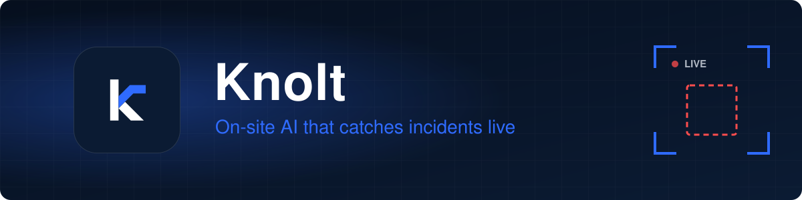

  

  <a href="https://knolt.ca"><b>knolt.ca</b></a> · Montreal, Canada

**Knolt turns the cameras a business already owns into a live analyst for security and operations.** When something needs attention, the right person gets an alert within seconds, with the clip that shows it. Everything runs on site, so footage never leaves the building.

## What Knolt does

| | |
| :-- | :-- |
| 🚨 **Catches incidents live** | Robberies and weapons are flagged within seconds, each with a timestamped evidence clip. |
| 🔎 **Lets staff ask the footage** | Plain-language questions, in English or French, such as *"who entered the vault after closing?"*, answered with the moments that prove it. |
| 🏢 **Runs inside the building** | Tracking, alerts and search run on one box on site. No cloud dependency, no footage leaving the premises. |
| 🧭 **Understands scenes, not objects** | One engine reads what people are doing and what they do to each other, so new use cases are new questions, not new products. |

## Who it's for

Banks and regulated businesses first, then every business with cameras: shops, venues, arcades, restaurants and offices. Next on the roadmap: ATM and branch fraud, theft and restricted zones, and safety alerts such as falls, fights, medical emergencies, fire and smoke.

## How we build

- **People decide.** Every alert is a candidate for a person to review, never a verdict.
- **Privacy by default.** No face recognition unless a customer opts in where the law allows.
- **Trust is measured.** We test every change on footage the model has never seen and track false alerts per camera-hour.

## Work with us

Our product repositories are private. To see a demo, pilot Knolt on your cameras, or join the team, reach us through **[knolt.ca](https://knolt.ca)**.
